<div align="center">



[](https://nixos.org)
[](https://code.claude.com/docs/en/desktop-linux)
[](https://code.claude.com/docs/en/desktop)
[](#status)
[](#disclaimer)
[](#disclaimer)

**Claude Desktop (Chat · Code · Cowork) as a Nix flake for NixOS,
built from Anthropic's official Linux package.**

</div>

> [!WARNING]
> **This is an unofficial repack.** Anthropic ships the Linux app (beta) for Ubuntu and Debian
> only and does not support NixOS. Please don't take issues with this flake to Anthropic support.
> The repository contains no Anthropic binaries: the `.deb` is fetched from
> `downloads.claude.ai` at build time and pinned by hash.

---

## Contents

- [Quick start](#quick-start)
- [Installation](#installation)
- [Packages](#packages)
- [How it works](#how-it-works)
- [Claude Code inside Desktop](#claude-code-inside-desktop)
- [MCP and configuration](#mcp-and-configuration)
- [Wayland](#wayland)
- [Updating](#updating)
- [Status](#status)
- [Limitations](#limitations)
- [Troubleshooting](#troubleshooting)
- [Development](#development)
- [Disclaimer](#disclaimer)

## Quick start

```sh
nix run github:ilqqy/claude-desktop-flake
```

No unfree configuration needed: the flake allows unfree for this package only.

## Installation

### NixOS (flake)

```nix
# flake.nix
{
  inputs = {
    nixpkgs.url = "github:NixOS/nixpkgs/nixos-unstable";
    claude-desktop = {
      url = "github:ilqqy/claude-desktop-flake";
      inputs.nixpkgs.follows = "nixpkgs";
    };
  };

  outputs = { nixpkgs, ... }@inputs: {
    nixosConfigurations.<host> = nixpkgs.lib.nixosSystem {
      specialArgs = { inherit inputs; };
      modules = [ ./configuration.nix ];
    };
  };
}
```

```nix
# configuration.nix
{ pkgs, inputs, ... }:
{
  environment.systemPackages = [
    inputs.claude-desktop.packages.${pkgs.stdenv.hostPlatform.system}.default
  ];

  # Secret Service so your sign-in persists (GNOME/KDE already provide one)
  services.gnome.gnome-keyring.enable = true;
}
```

Then run `sudo nixos-rebuild switch`.

<details>
<summary><b>Via overlay (<code>pkgs.claude-desktop</code>)</b></summary>

```nix
{ pkgs, lib, inputs, ... }:
{
  nixpkgs.overlays = [ inputs.claude-desktop.overlays.default ];
  nixpkgs.config.allowUnfreePredicate = pkg:
    builtins.elem (lib.getName pkg) [ "claude-desktop" "claude-desktop-unwrapped" ];

  environment.systemPackages = [ pkgs.claude-desktop ];
}
```

The overlay builds against your own nixpkgs, so unfree has to be allowed in your config, as shown above.

</details>

<details>
<summary><b>Home Manager</b></summary>

```nix
{ pkgs, inputs, ... }:
{
  home.packages = [
    inputs.claude-desktop.packages.${pkgs.stdenv.hostPlatform.system}.default
  ];
}
```

</details>

<details>
<summary><b>No config at all: <code>nix profile</code></b></summary>

```sh
nix profile add github:ilqqy/claude-desktop-flake
nix profile upgrade claude-desktop-flake   # update
nix profile remove claude-desktop-flake    # uninstall
```

</details>

## Packages

| Attribute | Description |
|---|---|
| `default`, `claude-desktop` | the app inside an FHS environment, **recommended** |
| `claude-desktop-cowork` | same, plus QEMU/KVM, OVMF and virtiofsd for Cowork (≈ +1.5 GB) |
| `claude-desktop-unwrapped` | no FHS: Chat works, Code only with `programs.nix-ld.enable = true` |

You can add extra packages to the FHS env, e.g. for MCP servers:

```nix
inputs.claude-desktop.packages.${system}.default.override {
  extraPkgs = pkgs: [ pkgs.docker-client pkgs.go ];
}
```

<details>
<summary><b>Cowork requirements</b></summary>

- the `claude-desktop-cowork` package;
- hardware virtualization enabled, and your user in the `kvm` group
  (`users.users.<you>.extraGroups = [ "kvm" ];`);
- the `vhost_vsock` kernel module (`boot.kernelModules = [ "vhost_vsock" ];`).

</details>

## How it works

```
downloads.claude.ai/claude-desktop/apt/stable          (official apt repo, no auth required)
        │  fetchurl, pinned sha256
        ▼
claude-desktop_<ver>_<arch>.deb
        │  dpkg-deb → autoPatchelfHook          app.asar is NOT modified
        ▼
claude-desktop-unwrapped                       bundled Electron 44 + Linux builds of claude-native / node-pty
        │  buildFHSEnv (bubblewrap)
        ▼
claude-desktop                                 /bin/bash, /usr/bin/*, /lib64/ld-linux, node, uv, git …
```

**Why this design:**

1. **Not nixpkgs' electron.** The app loads its locales, helpers and VM image from
   `process.resourcesPath`, which Electron derives from `/proc/self/exe`. So the flake keeps the
   Electron that ships in the `.deb` and fixes it up with `autoPatchelfHook`.
2. **The Code tab needs FHS.** Desktop downloads a glibc build of Claude Code at runtime and
   calls `/bin/bash`, `/usr/bin/pgrep`, `/usr/bin/secret-tool` and friends by absolute path.
   None of that works on NixOS without `nix-ld`.
3. **No stubs.** Older community projects (k3d3, aaddrick ≤ 2.x) repacked the Windows installer
   and stubbed out native modules. The official `.deb` already has Linux builds of them.

## Claude Code inside Desktop

You **don't** need to install the CLI separately (`@anthropic-ai/claude-code` or the native build),
and Desktop doesn't use a `claude` from your `PATH`.

- `app.asar` embeds a manifest for one exact version (**2.1.308** for 3.6556.2) with a sha256 per platform;
- the first time you use the Code tab, Desktop downloads
  `downloads.claude.ai/claude-code-releases/<ver>/linux-x64/claude.zst`, checks the hash and installs it
  into `~/.config/Claude/claude-code/`;
- after that, Desktop keeps that copy updated itself (`[CCD-autoupdate]`). This happens at runtime,
  not at build time, so Nix doesn't track it.

## MCP and configuration

Everything lives in `~/.config/Claude/` (override with `CLAUDE_USER_DATA_DIR`).

```jsonc
// ~/.config/Claude/claude_desktop_config.json
{
  "mcpServers": {
    "filesystem": {
      "command": "npx",
      "args": ["-y", "@modelcontextprotocol/server-filesystem", "/home/me/projects"]
    }
  }
}
```

According to the [docs](https://code.claude.com/docs/en/desktop), the Code tab picks these servers up,
along with `~/.claude.json` and the project's `.mcp.json`.

The FHS env already includes `node` / `npx`, `uv` / `uvx`, `python3`, `git`, `ssh`, `bwrap` and `socat`.
Your regular `PATH` (`/run/current-system/sw/bin`, `~/.nix-profile/bin`) is available too, after `/usr/bin`.

## Wayland

Electron ≥ 38 defaults to `--ozone-platform=auto`, so in a Wayland session the app already runs
natively. With `NIXOS_OZONE_WL=1` set, the wrapper also passes:

```
--ozone-platform=wayland --enable-wayland-ime=true
```

> [!NOTE]
> `--ozone-platform-hint=auto` is deliberately omitted: the bundled Electron 44 no longer has that flag.
> To force XWayland, run `claude-desktop --ozone-platform=x11`.

## Updating

```sh
./update.sh          # bump package.nix to the latest release
./update.sh --check  # exit 1 if an update is available (handy for CI)
```

Chain of trust:

```
key fingerprint 31DD DE24 DDFA B679 F42D  7BD2 BAA9 29FF 1A7E CACE  (from Anthropic's docs)
  → GPG signature of InRelease
    → SHA256 of the Packages indexes
      → SHA256 of the .deb, which must match nix-prefetch-url's result
```

The script only rewrites the `# BEGIN update.sh … # END update.sh` block in `package.nix`.
As a user of the flake, you update with `nix flake update claude-desktop` followed by a rebuild.

## Status

Tested on `x86_64-linux` with 3.6556.2.

| | What | How it was tested |
|:-:|---|---|
| ✅ | Build, `nix flake check` | `auto-patchelf: 0 dependencies could not be satisfied` |
| ✅ | X11 launch | Xvfb: `com.anthropic.Claude` window, the "Claude for Linux" screen renders |
| ✅ | Wayland launch | headless sway: native `xdg_shell`, Ozone flags applied |
| ✅ | `claude://` links | handler is registered in `mimeapps.list`; a second instance hands the URL to the first |
| ✅ | Claude Code 2.1.308 | `claude --version` works in FHS; without FHS and without nix-ld it fails with `No such file or directory` |
| ✅ | Keyring | Secret Service reachable from FHS (gnome-keyring) |
| ⚠️ | Sign-in, Code sessions, MCP | not tested: requires an account |
| ⚠️ | aarch64 | evaluates, hash verified, not built |
| ⚠️ | Cowork | only the OVMF layout was checked; booting the VM was not tested |
| ⚠️ | Quick Entry hotkey | on Wayland it needs your DE's GlobalShortcuts portal |
| ❌ | In-app auto-update | absent in the official Linux build too; update via `nix flake update` |
| ❌ | Computer Use, dictation | not in the official Linux beta |

## Limitations

These come from the FHS environment (bubblewrap):

- **`sudo` doesn't work in Code sessions**, because `NoNewPrivs` is set;
- **only part of the host's `/etc` is visible**: `passwd`, `hosts`, `resolv.conf`, `ssl/certs` and similar
  are there, but `/etc/ssh/ssh_config` and `/etc/gitconfig` are not. `~/.ssh` and `~/.gitconfig` work fine;
- if your browser isn't running when you sign in, `xdg-open` will start it **inside** the FHS env,
  so open your browser beforehand;
- `chrome-sandbox` has no SUID bit. Chromium falls back to the user-namespace sandbox, which NixOS
  enables by default.

## Troubleshooting

<details>
<summary><b>Sign-in isn't saved, it asks me to log in on every launch</b></summary>

You need a working Secret Service: `services.gnome.gnome-keyring.enable = true;`, or KWallet on KDE.
On first launch gnome-keyring may ask you to set a password for a new keyring.

</details>

<details>
<summary><b>The app doesn't open after signing in in the browser</b></summary>

`claude://` links must open through `com.anthropic.Claude.desktop`. The package has to be installed
(via `environment.systemPackages`, Home Manager or `nix profile`), not just run from `./result`. Check with:

```sh
xdg-mime query default x-scheme-handler/claude   # → com.anthropic.Claude.desktop
```

</details>

<details>
<summary><b>Where are the logs?</b></summary>

`~/.config/Claude/logs/main.log`, plus stdout if you start `claude-desktop` from a terminal.

</details>

## Development

```sh
nix develop      # asar, dpkg, gnupg, curl, nixfmt
nix fmt          # nixfmt-tree
nix flake check  # build + formatting check
```

| File | Purpose |
|---|---|
| `flake.nix` | `packages`, `apps`, `overlays`, `devShells`, `formatter`, `checks` |
| `package.nix` | `.deb` unpacking, `autoPatchelfHook`, Wayland wrapper, FHS env |
| `update.sh` | bumps version and hashes from the signed apt index |
| `assets/banner.svg` | animated header (CSS/SMIL, honours `prefers-reduced-motion`) |

## Disclaimer

Claude and Claude Desktop are products and trademarks of Anthropic PBC. This project is not
affiliated with or endorsed by Anthropic. The application itself is proprietary
(`meta.license = lib.licenses.unfree`) and is only ever downloaded from Anthropic's servers.
The Linux app is in beta. Use at your own risk.

Links: [Claude Desktop on Linux](https://code.claude.com/docs/en/desktop-linux) ·
[Claude Code Desktop](https://code.claude.com/docs/en/desktop) ·
[aaddrick/claude-desktop-debian](https://github.com/aaddrick/claude-desktop-debian) ·
[k3d3/claude-desktop-linux-flake](https://github.com/k3d3/claude-desktop-linux-flake)
